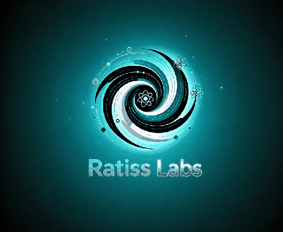
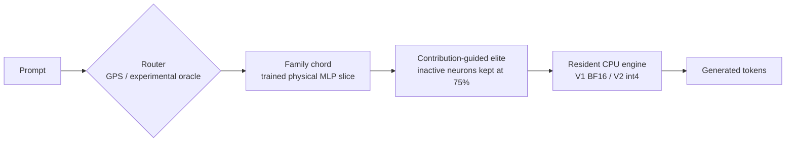

<p align="center">
  
</p>

<h1 align="center">RATISS-X</h1>

<p align="center">
  <strong>The LLM Mixer — Thinking in Paths</strong><br>
  Sparse activation paths, physical MLP slices, contribution-guided elites,<br>
  and frugal CPU-native inference.
</p>

<p align="center">
  <a href="LICENSE"></a>
  <a href="https://github.com/jonathansearch"></a>
  <a href="https://orcid.org/0009-0000-4092-5313"></a>
  
  
</p>

<p align="center">
  <strong>RATISS Labs</strong> · Jonathan Evina · Yaoundé, Cameroon 🇨🇲<br>
  <em>Independent, single-author research. Open, sealed, and reproducible.</em>
</p>

---

> **Do not transform the whole fog of a dense LLM. Learn to read its paths —
> then teach it to think in paths.**

## What is RATISS-X?

A dense language model activates its full MLP machinery for every token.
**RATISS-X explores the opposite direction:** identify reusable activation
paths — called **chords** — route an input to the relevant chord, physically
extract and train only that slice, and preserve enough of the remaining network
for stable autoregressive generation.

The reference model is **SmolLM2-360M**. No model weights are versioned in this
repository. All experiments are CPU-only, protocols are written before the
measurements, raw generations are published, and failures remain in the record.



> **Status:** research programme, not a production model. **RATISS VEGA has not
> been declared.** Its name, scope, and birth criteria remain decisions for the
> laboratory director.

## Headline results

| Question | Measured answer |
|---|---|
| Can physical MLP slices be trained across all 32 layers? | **Yes.** Loss **6.17 → 1.245 (−79.8%)**, with about **21× fewer updated parameters per step** than the dense MLP comparison. |
| Is the custom NumPy engine faithful? | **Yes.** At equal mode, logits cosine versus PyTorch reached **1.0000**. |
| Does a magnitude-ranked neuron background stabilize generation? | **No.** No 70–95% magnitude background reached the predeclared 4/6 stability threshold. Only 100% reached 6/6. |
| Does matched training rescue the 75% magnitude regime? | **Not yet.** Loss improved **8.87 → 3.82 (−57%)**, but generation reached only **2/6**. |
| Which inactive neurons should be kept? | **The neurons that actually contribute.** Ranking by `E\|activation\| × ‖W_down‖` produced **5/6 stable generations at a 75% background**. |
| Can one GPS centroid route both questions and sentence openings? | **No universal router passed.** Questions-only: 93.3% questions / 30.6% openings. Openings-only: 20.0% / 72.2%. Mixed: 81.7% / 47.2%. |
| Does resident execution make sparsity pay? | **Yes.** V1 hybrid: **0.94–0.96 s/token**, versus **1.28–1.30 s/token** for resident dense execution. |
| Can the engine fit below 300 MB? | **Yes, as a prototype.** V2 int4 peaked at **286 MB**, but ran at **3.6–4.0 s/token** with mixed output quality. |

Full evidence: [Final Scientific Sprint report](docs/RAPPORT_SPRINT_FINAL_SCIENTIFIQUE.md)
and the [RATISS construction briefing](docs/PRET_POUR_RATISS.md).

## Visual overview

| Activation paths and GPS | Physical slicing |
|---|---|
|  |  |
| **Semantic translation** | **CPU efficiency** |
|  |  |

## Repository map

```text
RATISS-X/
├── assets/       Official RATISS Labs visual identity
├── data/         Frozen questionnaires, prompts, and test sets
├── docs/         Protocols, reports, reproducibility journal, figures
├── results/      Machine-readable experimental results (JSON)
├── src/          GPS routers, slicing, training, and native engines
├── tests/        Unit and engine-equivalence tests
├── LICENSE       MIT License
└── MANIFESTE.json  SHA-256 seal for the validated repository files
```

## Quick start

### 1. Install

```bash
git clone https://github.com/jonathansearch/RATISS-X.git
cd RATISS-X
python3 -m pip install numpy torch transformers tokenizers \
  huggingface-hub safetensors scikit-learn pytest
```

### 2. Run the lightweight tests

```bash
python3 -m pytest tests/test_bistouri_physique.py tests/test_gps.py -q
```

Expected at the current seal: **11 tests pass**.

### 3. Run the GPS demonstration

```bash
python3 src/demo_gps.py
```

The demonstration downloads the reference model's tokenizer and embedding
table, then routes unseen questions without executing a Transformer layer.

### 4. Explore the engines and experiments

- Resident BF16 engine: `src/moteur_v1.py`
- int4 memory prototype: `src/moteur_v2.py`
- Matched-regime training: `src/entrainement_apparie.py`
- Prompt-router comparison: `src/gps_amorces.py`
- Free-generation threshold tests: `src/seuil_generation.py`

Some experiments require locally generated training slices. Heavy artifacts
are deliberately excluded from Git; exact regeneration commands and ordering
are recorded in the [reproducibility journal](docs/JOURNAL_REPRODUCTIBILITE.md).

## Documentation

Start with the [visual documentation index](docs/INDEX.md).

| Need | Document |
|---|---|
| Final scientific position | [Final Scientific Sprint](docs/RAPPORT_SPRINT_FINAL_SCIENTIFIQUE.md) |
| What is ready for RATISS construction | [Construction briefing](docs/PRET_POUR_RATISS.md) |
| Exact replay history | [Reproducibility journal](docs/JOURNAL_REPRODUCTIBILITE.md) |
| Resident engine V1 | [V1 engine report](docs/RAPPORT_MOTEUR_V1.md) |
| Free-generation threshold | [G1 generation report](docs/RAPPORT_SEUIL_GENERATION_G1.md) |
| Full-model slice training | [E4 extension report](docs/RAPPORT_EXTENSION_E4.md) |
| Frozen sprint protocol | [Final sprint protocol](docs/PROTOCOLE_SPRINT_FINAL_SCIENTIFIQUE.md) |

Most historical protocols and reports are in French; this README and the
documentation index provide the English entry point.

## Method

RATISS Labs applies the same rules everywhere:

1. **Criteria before experiments.** A test that cannot fail is forbidden.
2. **Controls are mandatory.** Engines are compared with the reference they claim to reproduce.
3. **Failures are published.** Refuted shortcuts and unstable generations stay visible.
4. **Raw outputs remain raw.** Generated text is not polished after measurement.
5. **Repositories are sealed.** SHA-256 hashes make silent modification visible.
6. **One human decides; AI systems execute.** Questions, priorities, and final verdicts belong to the laboratory director.

## Limitations

- The 5/6 activation-guided result uses six English prompts and oracle family routing.
- The specialized GPS routers do not yet have a validated automatic mode selector.
- V2 int4 proves the memory target, not production speed or quality.
- Results are specific to SmolLM2-360M, this CPU environment, and the frozen test sets.
- This is independent research and is **not presented as peer-reviewed**.

## License and authorship

Released under the [MIT License](LICENSE).

**Jonathan Evina** — Founder and sole author, **RATISS Labs**, Yaoundé, Cameroon 🇨🇲
GitHub: [@jonathansearch](https://github.com/jonathansearch) · ORCID:
[0009-0000-4092-5313](https://orcid.org/0009-0000-4092-5313)

<p align="center"><em>We measure. We name. We publish. 😜🥳</em></p>
