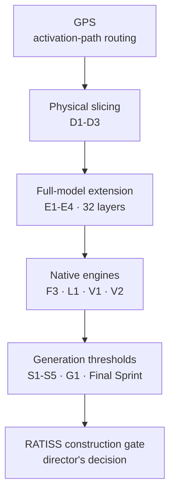

  

# RATISS-X Documentation

**English navigation for the complete RATISS-X evidence trail.**  
Most original protocols and reports are written in French; their filenames and
scientific status are preserved exactly as sealed.

## Start here

| Priority | Question answered | Document |
|---:|---|---|
| 1 | What did the final scientific sprint establish? | [Final Scientific Sprint report](RAPPORT_SPRINT_FINAL_SCIENTIFIQUE.md) |
| 2 | What is ready — and what remains undecided — for RATISS construction? | [Construction briefing](PRET_POUR_RATISS.md) |
| 3 | How can every stage be replayed? | [Reproducibility journal](JOURNAL_REPRODUCTIBILITE.md) |
| 4 | Which criteria were frozen before the sprint? | [Final sprint protocol](PROTOCOLE_SPRINT_FINAL_SCIENTIFIQUE.md) |

## Evidence map

## Validated results

| Area | Key reports | Machine-readable results |
|---|---|---|
| Full-model slice training | [E4](RAPPORT_EXTENSION_E4.md), [E4 generation](RAPPORT_GENERATION_E4.md) | `results/RESULTATS_EXTENSION_E4.json` |
| Resident BF16 engine | [V1](RAPPORT_MOTEUR_V1.md) | `results/RESULTATS_MOTEUR_V1_hybride.json`, `results/RESULTATS_MOTEUR_V1_dense.json` |
| Contribution-guided elite | [Final Sprint](RAPPORT_SPRINT_FINAL_SCIENTIFIQUE.md) | `results/RESULTATS_SEUIL_GENERATION_75_activation.json` |
| int4 memory prototype | [Final Sprint](RAPPORT_SPRINT_FINAL_SCIENTIFIQUE.md) | `results/RESULTATS_MOTEUR_V2_INT4.json` |
| GPS routing | [GPS Stage 1](RAPPORT_ETAPE1_GPS.md), [Final Sprint](RAPPORT_SPRINT_FINAL_SCIENTIFIQUE.md) | `results/RESULTATS_GPS_360M.json`, `results/RESULTATS_GPS_AMORCES.json` |

## Refuted or limited routes

| Route | Verdict |
|---|---|
| Magnitude-ranked backgrounds, 70–95% | No free-generation threshold found |
| Matched training with a magnitude elite | Better loss, only 2/6 stable generations |
| One mixed GPS centroid | Improves openings but loses too much on questions |
| int4 V2 as the final engine | Memory target reached; speed and quality not validated |

## Historical trail

1. **GPS and path discovery** — `PROTOCOLE_GPS.md`, Stage 1 reports.
2. **Semantic translation and physical slicing** — D1–D3 reports.
3. **Causal extension and memory campaign** — E1–E4 and M1–M3 reports.
4. **Dense duel, routing tests, native engine** — F1–F3 and L1 reports.
5. **Stabilization thresholds** — S1–S5, E5, and G1 reports.
6. **Resident engines and final sprint** — V1, V2, matched training,
   activation-guided elites, and prompt routing.

## Figures

| Figure | Subject |
|---|---|
| [Figure 1](images/fig1_chemins_gps.png) | Activation paths and GPS routing |
| [Figure 2](images/fig2_bistouri.png) | Physical MLP slicing |
| [Figure 3](images/fig3_traducteur.png) | Semantic translation |
| [Figure 4](images/fig4_efficacite_cpu.png) | CPU efficiency |

---

**RATISS Labs** · Jonathan Evina · Yaoundé, Cameroon 🇨🇲 · MIT License
