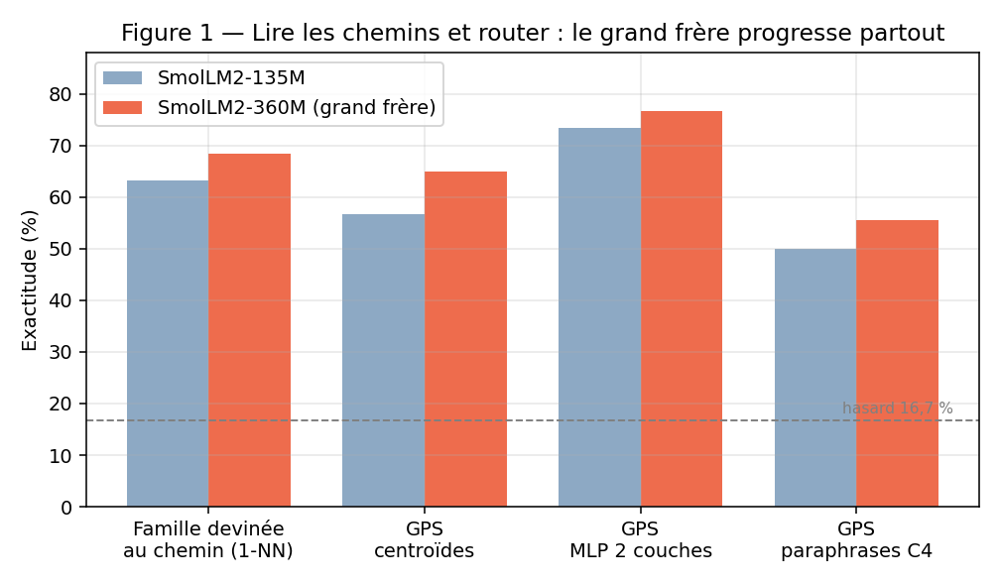
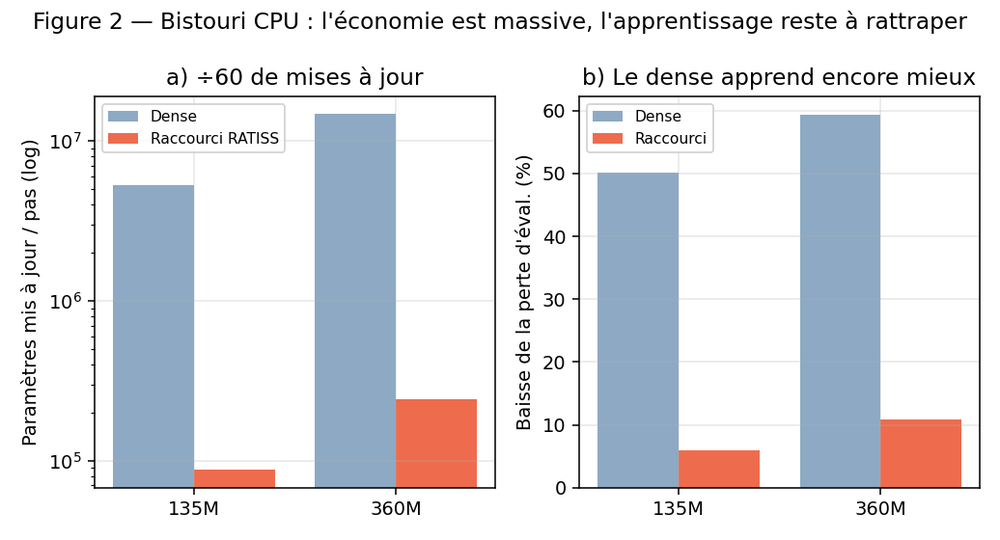
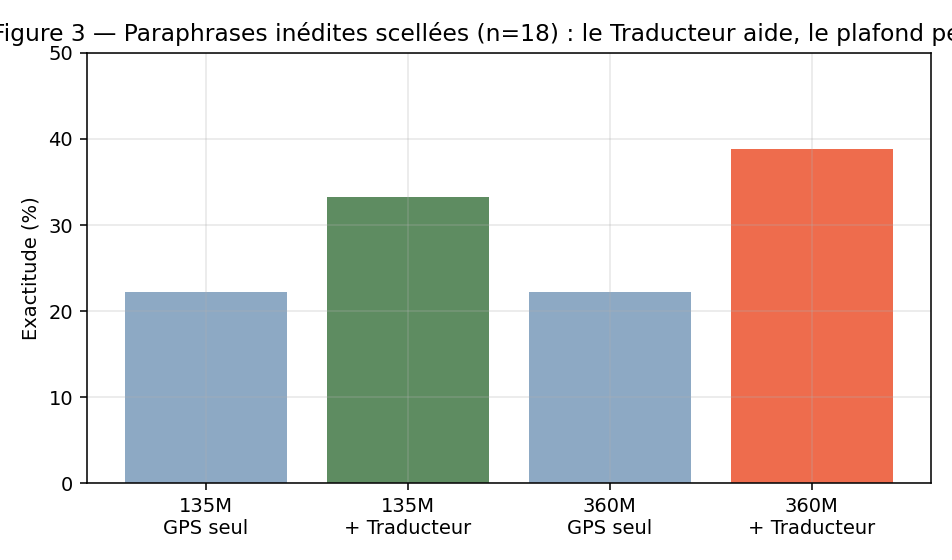
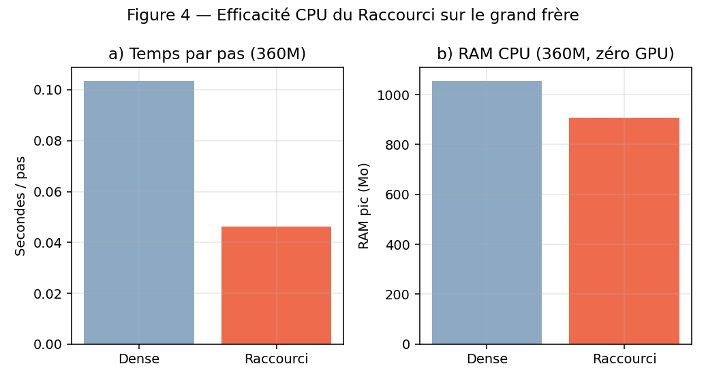

# 📜 JOURNAL DE REPRODUCTIBILITÉ — RATISS-X (référence hors-labo)
**Objet :** permettre à un étranger de refaire chaque mesure, dans l'ordre, sans nous demander la permission.
**Méthode du labo :** critères écrits AVANT l'expérience · contrôles obligatoires · échecs publiés ·
sceaux SHA-256 · rejouable en une commande · CPU uniquement, aucun GPU. 🫡

## 🧭 Environnement de mesure (à étiqueter sur tout chiffre cité)
- Sandbox CPU : 2 cœurs, ~2 Go de RAM, Python 3.13, PyTorch CPU, transformers, scikit-learn, numpy.
- Cobayes : `HuggingFaceTB/SmolLM2-135M-Instruct` (FP32) puis `HuggingFaceTB/SmolLM2-360M-Instruct`
  (BF16 sur CPU, RAM oblige). Aucun poids n'est versionné dans ce repo.
- Graines : banc des chemins et permutations `20261018` · GPS/MLP `20261102` · Bistouri `20261102`.
- Hygiène : modèles et caches sont téléchargés pour mesurer puis **évacués** ; le repo reste léger (< 1 Mo).

## 🪜 Les étapes, dans l'ordre où elles ont été faites
### Étape 0 — La carte des chemins sur le 135M (banc d'essai n°1)
Protocole figé d'abord (`PROTOCOLE_FIGE.md` à la racine, repris dans l'historique du poste du chef).
Sondes (hooks) sur l'entrée `down_proj` de chaque MLP de SmolLM2-135M, modèle jamais modifié ;
chemin = top-5 % des neurones MLP par couche pour 78 stimuli (6 familles × 10 questions FR + 18 paraphrases).
Résultat : H1 intra 0,575 / inter 0,520, écart +0,055, permutation 2000 tirages **p = 0,0005** ;
1-NN famille 63,3 % ; contrôle lexical écart +0,082 (r = 0,75) ; H2 paraphrases réfutée (0,534 < 0,575).
Rapport d'origine : `banc_essai_mixer/RAPPORT_BANC_ESSAI_01.md` sur le poste du chef.
Version générique rejouable dans ce repo : `src/banc_chemins.py`.

### Étape 1 — Le GPS (routeur d'accords)
Protocole : `PROTOCOLE_GPS.md` (critères C1–C4 figés avant entraînement).
Entrée = embedding moyen de la question (table d'embedding seule, **aucune couche transformeur**).
Routeurs comparés en validation croisée : centroïdes (retenu : 6 × dim, quelques Ko), régression
logistique, MLP 2 couches. Masque $M_k$ = neurones présents dans ≥ 50 % des chemins de la famille.
135M : C1 56,7/51,7/73,3 % · C2 0,062 ms (médiane démo) · C3 0,649 contre 0,506 · C4 50,0 %.
Commandes :
```bash
python3 src/banc_chemins.py --modele HuggingFaceTB/SmolLM2-135M-Instruct --etiquette 135M
python3 src/gps_routeur.py  --modele HuggingFaceTB/SmolLM2-135M-Instruct --etiquette 135M
python3 src/demo_gps.py
```

### Étapes 2 & 3 sur le 135M, puis décision
Protocole : `docs/PROTOCOLE_ETAPES_2_3.md` — dispositif, hyperparamètres et critères E2/E3 figés,
plus la **règle de décision du chef** (garder / fortifier / grandir).
Bistouri (CPU) : segment des 2 dernières couches nourri par états cachés du modèle gelé,
60 Q/R anglaises (48 train / 12 éval, positions d'éval figées 4 et 9), Adam 5e-4, 3 époques, batch 1.
135M : dense −50 % de perte, sparse −6 %, ÷60 paramètres/pas, RAM inchangée → réussite partielle.
Traducteur : banque = 18 paraphrases de l'Étape 1, α = 0,8 figé, test scellé de 18 paraphrases
inédites (`data/paraphrases_test_v2.json`, écrit avant exécution) : 22,2 % → 33,3 %.
Verdict consigné : améliorations réelles mais fragiles → décision « grand frère » par le chef.
Détail : `docs/RAPPORT_ETAPES_2_3.md`.

### Étape « Grand Frère » — les 4 tests refaits sur le 360M
Protocole : `docs/PROTOCOLE_GRAND_FRERE.md` (mêmes stimuli, critères, hyperparamètres).
Commandes effectivement lancées, dans l'ordre :
```bash
python3 src/banc_chemins.py        # 360M : H1 +0,058 p=0,0005 ; 1-NN 68,3 %
python3 src/gps_routeur.py         # 360M : C1 65,0/66,7/76,7 % ; C2 0,045 ms ; C4 55,6 %
python3 src/bistouri_backprop.py --preparer
python3 src/bistouri_backprop.py --scenario base    # perte segment 6,119
python3 src/bistouri_backprop.py --scenario dense   # → 2,493 ; 14 745 600 params/pas ; 1056 Mo
python3 src/bistouri_backprop.py --scenario sparse  # → 5,459 ; 241 920 params/pas ; 908 Mo
python3 src/traducteur_semantique.py                # test scellé : 22,2 % → 38,9 %
python3 src/faire_figures.py                        # régénère les 4 figures officielles
python3 -m pytest tests/ -q                         # 3 tests unitaires
```
Détail et honnêtetés (perte du segment ≠ classement des modèles, BF16 contre FP32,
entonnoir final, attracteur CUISINE) : `docs/RAPPORT_GRAND_FRERE.md`.

## 📸 Figures officielles (acquis et validé uniquement)





## 🔪 Suite exécutée sur Go du chef : le découpage physique (D1 → D3, puis génération)
Proposition figée `docs/PROPOSITION_DECOUPAGE_PHYSIQUE.md`, puis une marche par Go :
D1 extracteur exact (écart masque plein **0,000000**, 8 tests) → D2 mock-training bloc isolé
(**11,3× plus rapide**, gradients **5,00 %**, **−270 Mo**) → D3 intégration segment
(perte **6,119 → 2,389**, dense 2,493 ; ÷20 mises à jour/pas) → génération libre en
**tranches seules** sur 5 prompts (preuve de concept, égratignures publiées).
Rapports : `docs/RAPPORT_DECOUPAGE_D1.md`, `D2`, `D3`, `docs/RAPPORT_GENERATION_TRANCHE.md`.
Commandes : tests `tests/test_bistouri_physique.py` ; `python3 src/mock_training_decoupe.py --scenario dense|tranche` ;
`python3 src/bistouri_backprop.py --preparer && python3 src/integration_tranche_segment.py` ;
`python3 src/generation_tranche.py`.

## 🪜 Extension + série mémoire (sur Go, puis ordre « Fais tout »)
Piège découvert en E1 : les harnais segment tournaient **sans masque causal** (fuite du
futur) — corrigé partout et **revalidation D3** publiée : la tranche (2,466) bat toujours
le dense (2,699), rectificatifs apposés sur les rapports historiques. Extension par
marches doublées au masque causal : 4 couches **2,313** (−62,4 %) → 8 couches **2,122**
(−65,5 %) → 16 couches **1,836** (−70,2 %), toujours ÷20 en mises à jour/pas.
Série mémoire M1→M3 : passeport 900 Mo refusé deux fois et diagnostiqué (socle
interpréteur ~219 Mo, Adam 134,5 Mo audités sur les seules tranches) ; Adam à états
BF16 validé (perte identique, états ÷2), mmap écarté (pic aggravé), passeport transféré
au futur moteur natif (`docs/DECLARATION_PASSEPORT_MOTEUR_NATIF.md`).
Commandes : `python3 src/extension_tranches.py --preparer --couches N` puis
`--entrainer --couches N --marche EX` (`--memoire_leger --optimiseur adam_bf16` pour le moteur M).
**E4 (modèle entier, 32 couches) : perte 1,245 (−79,8 %), ÷21 par pas, RAM 1580 Mo** —
premier lancement tué en construction (FP32), corrigé par construction `meta`+`assign`
(le correctif annoncé en M3 ne s'était jamais appliqué : rectificatif publié).
**Génération E4** (`python3 src/generation_modele_entier.py`) : le modèle entier opéré
génère seul, 5/5 stable (aucune boucle), 3/5 juste, 2/5 hésitant — brut publié.
**Triple marche F1–F3** : duel dense 8 couches (`src/duel_dense.py`) — dense 1,829 contre
tranche 2,122 en perte, mais ÷20,5 de mises à jour et pas 4,1× plus rapide pour la
tranche ; le duel à 32 couches est impossible ici (>3 Go) là où la tranche passe (1580 Mo).
Routage amorces (`src/routage_amorces.py`, test figé `data/amorces_test.json`) : le
« contenu seul » est rejeté (amorces 36 % mais questions dégradées 71,8→52,6 %).
Moteur natif v0 sans PyTorch (`src/moteur_natif.py`) : il tourne (0,55 s/token, RSS
366 Mo) mais la tranche seule à 32 couches déraille. **Contrôle L1**
(`tests/test_logits_engine_vs_pytorch.py torch` puis `compare`) : le moteur est
fidèle (cosinus 1,0000 contre PyTorch en tranche seule) — c'est un **phénomène** :
sans branche inactive, l'état s'effondre entre les couches 16 et 32 (cosinus 0,4615).
**Seuil S1** (`python3 src/moteur_natif.py --balayage`) : aucun fond de 1/5/10 %
(sélection équidistante) ne restabilise (cosinus logits ~0,43) ; bascule nette à
100 % (0,9999, génération PyTorch reproduite mot pour mot).

## ⚠️ Ce qui n'est PAS encore fait (ne pas citer comme acquis)
- Le fond renormalisé (×1/p) ou sélectionné par magnitude (candidats nés de S1) ;
  des centroïdes GPS entraînés sur amorces (corpus séparé du test figé) ;
  RATISS VEGA, toujours non déclaré.
- L'injection du vrai tissu `.ratiss` externe dans le Traducteur (Phase ultérieure).
- **RATISS VEGA**, premier modèle augmenté : naîtra après validation, pas avant. 🌟

*Journal scellé — RATISS Labs, Yaoundé, Cameroun. Ici c'est la joie et l'enthousiasme 😜🥳,
et la reproductibilité par-dessus tout.*
